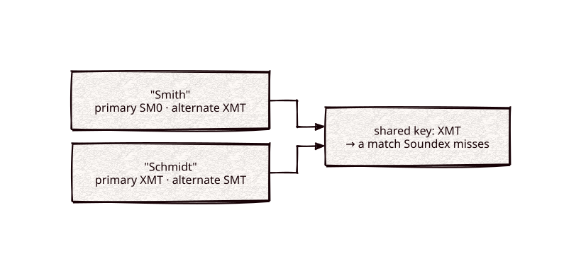

# double-metaphone

Part of [Kronuz C++ Libraries](https://github.com/Kronuz/cpp-libraries), a collection of small, reusable C++ libraries.

[](https://github.com/Kronuz/double-metaphone/actions/workflows/ci.yml)
[](LICENSE)


Double Metaphone for C++20: turn a word into two phonetic keys, its main English
pronunciation and a plausible foreign one, so "Smith" matches "Schmidt" and
"Catherine" matches "Kathryn". For name search and matching across spelling
variants.



## ✨ Highlights

- **Two keys per word**, primary and alternate; two words match if any of their
  keys agree.
- **Real-name rules**: silent letters, Germanic, Slavic, and Romance spellings,
  and the many English spellings of one sound.
- **A drop-in for [soundex](https://github.com/Kronuz/soundex)'s encoders**: the
  same `encode()` interface, returning the primary key.
- **No dependencies**: one header and one source file.

## 📦 Installation

Requires a C++20 compiler and CMake 3.14 or newer; it compiles one source file.
CI builds it on Linux (x86_64, arm64), macOS (arm64, x86_64), and FreeBSD, plus
ASan, UBSan, and TSan builds.

```cmake
include(FetchContent)
FetchContent_Declare(double_metaphone
  GIT_REPOSITORY https://github.com/Kronuz/double-metaphone.git
  GIT_TAG        main)
FetchContent_MakeAvailable(double_metaphone)

target_link_libraries(my_app PRIVATE double_metaphone::double_metaphone)
```

## 🚀 Quick start

```cpp
#include "double_metaphone.h"

#include <cassert>

int main() {
	DoubleMetaphone dm;
	assert(dm.encode("Smith") == "SM0");             // primary
	assert(dm.encode_alternate("Smith") == "XMT");   // alternate
	assert(dm.encode("Schmidt") == "XMT");           // meets Smith's alternate
}
```

[`examples/demo.cc`](examples/demo.cc) prints both keys for a list of names.

## 🎯 When to use it

- ✅ Names and words with varied spellings, mostly English or of European origin.
- ❌ Languages with their own phonetics (French, German, Spanish): soundex has
  language-specific encoders.
- ❌ Non-Latin scripts: it works on ASCII letters.

## 📚 Documentation

- [docs/API.md](docs/API.md): `encode`, `encode_alternate`, `encode_both`, and how
  to compare keys.
- [ARCHITECTURE.md](ARCHITECTURE.md): how the rule set is organized.
- [AGENTS.md](AGENTS.md): repository map and traps.

## 🛠️ Building and testing

```sh
cmake -B build && cmake --build build && ctest --test-dir build
./build/double_metaphone_demo
```

## 🤝 Contributing

Issues and pull requests are welcome. Keys are stored in indexes, so the output
must not change; read [AGENTS.md](AGENTS.md) first. CI must pass on every
platform.

## 📄 License

MIT, Copyright (c) 2015-2019 Dubalu LLC. See [LICENSE](LICENSE). The algorithm is
Lawrence Philips' (C/C++ Users Journal, June 2000).
